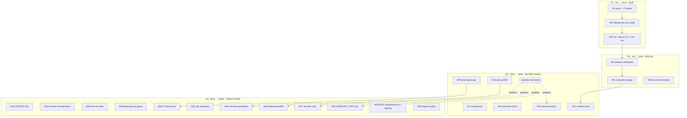

# Pareto Execution Plan — go-codec, 2026-10-16 06:40

> Point-in-time plan over `TODO_LIST.md` (#1–#23, all verified open 2026-10-16 06:35),
> `ROADMAP.md` (themes 1–7), and the 06:35 status report §f. Nothing here re-dispatches
> shipped work: every source row was verified against code/CHANGELOG in this morning's
> docs-health pass (298 verdicts, all gates green).
>
> **Verschlimmbessern guardrails:** no history rewrites (the daemon's `chore:` scoops
> stay — the 10-04 wipe incident lives in this repo's memory); no tag without the
> CHANGELOG section cut; no gate script change without its negative tests; the tripwire
> contract (identical full-patch string) is load-bearing — do not "simplify" it.

## The Pareto cut

| Tier | Share of tasks | Share of result | What it is | Why it carries the value |
| --- | --- | --- | --- | --- |
| **1%** | 1 thread (M1–M3) | **51%** | **Ship v0.3.2**: push the CI lint fix, confirm green, cut the CHANGELOG section, tag, live-fire `release.yml` | 30+ daemon commits of dependabot bumps, tooling, docs and fixes are stranded behind a tag. One release converts them into consumer-visible value, proves the release workflow, and ships the honest 1.27.1 floor. Everything else in this plan orbits it. |
| **4%** | +2 tasks (M4–M6) | **64%** | Release verification chain (GitHub Release, pkg.go.dev, scratch `go get`), consumer sweep (`go-cqrs-lite` `GOWORK=off`), pre-commit tripwire hooks | A release nobody verifies is a coin flip; a release nobody consumes is a trophy. The hooks kill the silent-drift class (two bumped `go.mod`s, one quoted-unsatisfiable gate) permanently. |
| **20%** | +7 tasks (M7–M13) | **80%** | erraudit pin bump, mermaid cache, bench-gate flake app, go-version policy ADR, daemon policy settlement, report rotation | Retires every recurring tax the status reports keep re-paying (pin drift, uncached CI, unwired tooling, unwritten policy, daemon noise, entombed reports). |
| **80%** | remaining 14 tasks | **100%** | Trims, normalization, structural guards, operator-gated decisions, ltx/research items, ROADMAP features | Real but demand-gated or cosmetic; scheduled so they stop rotting in snapshots. |

## Comprehensive plan (30–100 min tasks, ALL TODOs, impact-ordered)

| M# | Task (30–100 min) | Tier | Effort | Impact | Covers | Depends on |
| --- | --- | --- | --- | --- | --- | --- |
| M1 | Push master; confirm CI green on the golangci v2.14.0 pin (`gh run watch`) | 1% | 30m | Critical | report §f-2 | — |
| M2 | `release.yml`: add `workflow_dispatch` inputs, actionlint, dry-run exercise of gates + note-cutting | 4% | 45m | High | TODO #16 | M1 |
| M3 | Cut `[Unreleased]` → `[0.3.2]` (+ placeholders), annotated tag, push, watch **first live run** | 1% | 60m | Critical | TODO #14 | M2 |
| M4 | Release verification: GitHub Release notes/`--latest`, pkg.go.dev rendering, scratch-module `go get` | 4% | 40m | High | TODO #14 | M3 |
| M5 | Consumer sweep: bump `go-cqrs-lite/codec/v4` → v0.3.2, prove `GOWORK=off` build + tests | 4% | 60m | High | TODO #14 | M4 |
| M6 | Pre-commit tripwire hooks (go-version, error-codes, features-planned, erraudit) with fast-fail messaging | 4% | 45m | High | TODO #22 | — |
| M7 | erraudit pin bump v0.4.0 → v0.6.x (ci.yml install, flake devShell, `check-erraudit-version.sh` in lockstep) | 20% | 40m | Med | TODO #23 | — |
| M8 | Mermaid CI job: `actions/cache` for the npx/Chromium download | 20% | 30m | Med | TODO #17 | — |
| M9 | Wire `nix run .#bench-gate` app, shellcheck into devShell, `--selftest` mode for `wait_quiet` | 20% | 50m | Med | TODO #15 | — |
| M10 | ADR-0003 (next free number): go-version full-patch policy as written policy | 20% | 30m | Med | TODO #18 | — |
| M11 | Daemon policy implementation once the operator answers (§g-2 of the 06:35 report): exclusions, guard | 20% | 60m | Med | TODO #3 | ⏳ operator |
| M12 | Operator decision batch: ERRAUDIT_PAT vs publish, drafts filing, v0.1/v0.2 backfill | gates | 30m | High | TODO #1/#2/#8 | ⏳ operator |
| M13 | Rotation pass: ANNOTATE + archive `2026-10-16_06-35_….md`, HARVEST its §f into TODO_LIST/ROADMAP | 20% | 40m | Med | 09-26 §e-7 | next session |
| M14 | AGENTS.md trim pass back under ~15 KB (pair rule: no net-new bytes without a cut) | 80% | 45m | Low | TODO #20 | — |
| M15 | Archived-corpus cell-strike normalization (13 files, per-file `check-rows` gate) | 80% | 90m | Low | TODO #21 | — |
| M16 | CONTRIBUTING: non-nix path for the four tripwire scripts | 80% | 30m | Low | TODO #19 | — |
| M17 | CONTRIBUTING/AGENTS: contributor PAT-secrets note | 80% | 30m | Low | TODO #10 | M12 |
| M18 | Backfill (or skip) GitHub Releases v0.1.0/v0.2.0 | 80% | 30m | Low | TODO #8 | M12 |
| M19 | golangci CI-pin guard: floor/agreement tripwire or scripted bump | 80% | 40m | Med | ROADMAP t5 | — |
| M20 | Scheduled CI benchmark job behind bench-gate + bench-compare vs committed baseline | 80% | 60m | Med | ROADMAP t2 | M9 |
| M21 | CI job-summary step posting per-gate statuses | 80% | 40m | Low | ROADMAP t5 | — |
| M22 | Single-source version generation (one input writes go.mod/.go-version/.golangci.yml) | 80% | 100m | Med | ROADMAP t5 | M10 |
| M23 | ADR-0004 candidate note: compression-vs-signing invariant (ltx-derived) | 80% | 30m | Low | ROADMAP t5 | — |
| M24 | `nix flake check --all-systems` enablement (aarch64/darwin builders) | 80% | operator infra | Low | ROADMAP t5 | ⏳ infra |
| M25 | LiteStream+LTX evaluation for go-cqrs-lite SQLite engines (cross-repo) | 80% | cross-repo | Med | ROADMAP t5 | ⏳ operator |
| M26 | FEATURES/README indicative-figures policy (auto-propagate vs manual on re-baseline) | 80% | 30m | Low | report §f-28 | — |
| M27 | ERRAUDIT_PAT implementation once decided: secret, gate self-activation, fork-run verify | 80% | 40m | Med | TODO #1 | M12 |

Coverage check: TODO #1→M12/M27, #2→M12, #3→M11, #8→M12/M18, #10→M17, #14→M1–M5, #15→M9, #16→M2, #17→M8, #18→M10, #19→M16, #20→M14, #21→M15, #22→M6, #23→M7 — **all 15 open rows covered**, plus ROADMAP heads (M19–M25), the rotation (M13), and the figures policy (M26).

## Fine breakdown (≤12 min micro-tasks, ALL TODOs, execution order)

| ID | Micro-task (≤12 min) | Macro | Tier |
| --- | --- | --- | --- |
| 1.1 | `git push` master; capture run URL | M1 | 1% |
| 1.2 | `gh run watch` CI; verify lint legs 0 issues, tripwires PASS | M1 | 1% |
| 1.3 | If red: triage log, one-line fix, re-push (contingency) | M1 | 1% |
| 2.1 | Add `workflow_dispatch` trigger + version input to `release.yml` | M2 | 4% |
| 2.2 | `actionlint` over the edited workflow | M2 | 4% |
| 2.3 | Dispatch dry-run on master; read gate + note-cut logs | M2 | 4% |
| 2.4 | Fix anything the dry-run exposes; re-dispatch until clean | M2 | 4% |
| 3.1 | Cut `[Unreleased]` → `[0.3.2] — 2026-10-16`; leave placeholder categories | M3 | 1% |
| 3.2 | Curate release notes (no breaking changes — say so explicitly) | M3 | 1% |
| 3.3 | `grep '^replace'` + `go mod verify` + dual-mode build (pre-tag gates) | M3 | 1% |
| 3.4 | Create annotated tag `v0.3.2`; push commit+tag together | M3 | 1% |
| 3.5 | Watch `release.yml` first live run end-to-end | M3 | 1% |
| 3.6 | Contingency: workflow failure → fix, delete/re-tag per idempotent design | M3 | 1% |
| 4.1 | Verify GitHub Release exists, notes cut from CHANGELOG, `--latest` semantics | M4 | 4% |
| 4.2 | Verify pkg.go.dev: v0.3.2 Latest, README + examples render | M4 | 4% |
| 4.3 | Scratch module: `go get …@v0.3.2` + tiny program builds cold-cache | M4 | 4% |
| 5.1 | go-cqrs-lite: bump `codec/v4` require → v0.3.2 | M5 | 4% |
| 5.2 | `GOWORK=off` build + codec-dependent module tests | M5 | 4% |
| 5.3 | Record adoption proof in sibling CHANGELOG/AGENTS; note back here | M5 | 4% |
| 6.1 | Write `.githooks/pre-commit` running the four tripwire scripts | M6 | 4% |
| 6.2 | Fast-fail messages + `git config core.hooksPath .githooks` | M6 | 4% |
| 6.3 | Document in CONTRIBUTING; negative-test the hook (bad version → blocks) | M6 | 4% |
| 7.1 | Bump ci.yml `go install …@v0.6.x` | M7 | 20% |
| 7.2 | Bump flake devShell erraudit; update `check-erraudit-version.sh` pins | M7 | 20% |
| 7.3 | Run `nix run .#tripwires` + one local erraudit smoke | M7 | 20% |
| 8.1 | Add `actions/cache` (npx cache keyed on mermaid-cli version) to the mermaid job | M8 | 20% |
| 8.2 | `actionlint` + confirm cache restore in a dispatched run | M8 | 20% |
| 9.1 | Add `bench-gate` app to flake.nix (tripwires-style `mkApp`) | M9 | 20% |
| 9.2 | Add shellcheck to devShell; lint `scripts/bench-gate.sh`; fix findings | M9 | 20% |
| 9.3 | Add `--selftest` flag encoding the 4 `wait_quiet` scenarios | M9 | 20% |
| 9.4 | Run selftest + `nix run .#bench-gate --help` sanity | M9 | 20% |
| 10.1 | Read `docs/adr/0001` house style; draft ADR-0003 (full-patch policy, YAML-float trap, hardened tripwire) | M10 | 20% |
| 10.2 | Cross-link from AGENTS gotcha + TODO #18; delete the TODO row | M10 | 20% |
| 11.1 | Apply operator's daemon answer: exclusion patterns / split guidance | M11 | 20% |
| 11.2 | Add go.work/go.mod guard where the decision allows; record in AGENTS | M11 | 20% |
| 12.1 | Operator answers ERRAUDIT_PAT / drafts / backfill (their 30 min) | M12 | gates |
| 13.1 | ANNOTATE `2026-10-16_06-35_….md` §a–g inline (tool-driven) | M13 | 20% |
| 13.2 | HARVEST its §f: new rows / existing-row merges / declines with reasons | M13 | 20% |
| 13.3 | `check-rows` gate + `git mv` to `archived/` + manifest row | M13 | 20% |
| 14.1 | AGENTS: cut/compress v2-NDJSON gotcha + institutionalized-incident rows | M14 | 80% |
| 14.2 | Re-measure size (<15 KB target); verify all referenced paths still exist | M14 | 80% |
| 15.1 | Generate per-file PARTIAL row inventory (check-rows output → worklist) | M15 | 80% |
| 15.2 | Normalize files 1–4 (strike bare cells; `check-rows` after each) | M15 | 80% |
| 15.3 | Normalize files 5–8 (same gate discipline) | M15 | 80% |
| 15.4 | Normalize files 9–13; full-corpus `check-rows` exit 0; close TODO #21 | M15 | 80% |
| 16.1 | CONTRIBUTING "Repository checks without Nix": the four scripts, plain toolchain | M16 | 80% |
| 17.1 | CONTRIBUTING/AGENTS: sibling-secrets note (pattern per M12 outcome) | M17 | 80% |
| 18.1 | Backfill v0.1.0/v0.2.0 Releases from CHANGELOG sections (or record explicit skip) | M18 | 80% |
| 19.1 | Choose guard shape (floor tripwire vs pinned-bump script); implement | M19 | 80% |
| 19.2 | Negative-test (simulate old pin) + document | M19 | 80% |
| 20.1 | Workflow skeleton: cron + bench-gate + bench-compare vs baseline summary | M20 | 80% |
| 20.2 | Artifact retention + failure notification; actionlint; dispatch test | M20 | 80% |
| 21.1 | Add `job_summary` step aggregating gate outcomes; verify rendering | M21 | 80% |
| 22.1 | Design input (single version source); write generator script | M22 | 80% |
| 22.2 | Wire into flake app; tripwire becomes generated-output check | M22 | 80% |
| 22.3 | Docs: AGENTS gotcha rewrite (detect-after-drift → generate); ADR link | M22 | 80% |
| 23.1 | Draft the compression-vs-signing invariant note; file as ADR or COSE docs section | M23 | 80% |
| 26.1 | Write the figures-propagation policy line into the baseline doc + FEATURES header | M26 | 80% |
| 27.1 | Store `ERRAUDIT_PAT` secret (fine-grained PAT, read: erraudit) | M27 | 80% |
| 27.2 | Confirm error-audit job self-activation; fork-run verification | M27 | 80% |

Operator-only (not micro-scheduled): M24 (builders), M25 (cross-repo product call), M12 (decisions feeding 11/17/18/27).

## Execution graph

Parallel lanes: M6/M7/M8/M9/M10 (P2) have no dependencies and can run while P0/P1 await CI or the operator; P3 items are independent except where the graph edges say otherwise.

## Errata (stale-backlog corrections, per skill Step 0)

- "Re-run the 10-run benchstat baseline" — was closed 2026-10-05 (dual-mode table in `docs/benchmark-baseline.md`); the remaining work is the scheduled CI job (M20), not another manual baseline.
- "v0.3.1 CHANGELOG section missing" — closed 2026-10-05 08:29; the section exists and this plan cuts v0.3.2 from `[Unreleased]` on top of it.
- "doc.go # Errors links" and "go-version tripwire hardening" — closed this morning; they appear here only as dependencies of M10/M22.

## Git workflow note

The working tree was clean at plan time (daemon scooped the 06:35 report as `f083e75`).
This plan file is committed with a detailed message and pushed per the operator's
explicit instruction; the push also carries the CI lint fix to a real `gh run` verdict.
